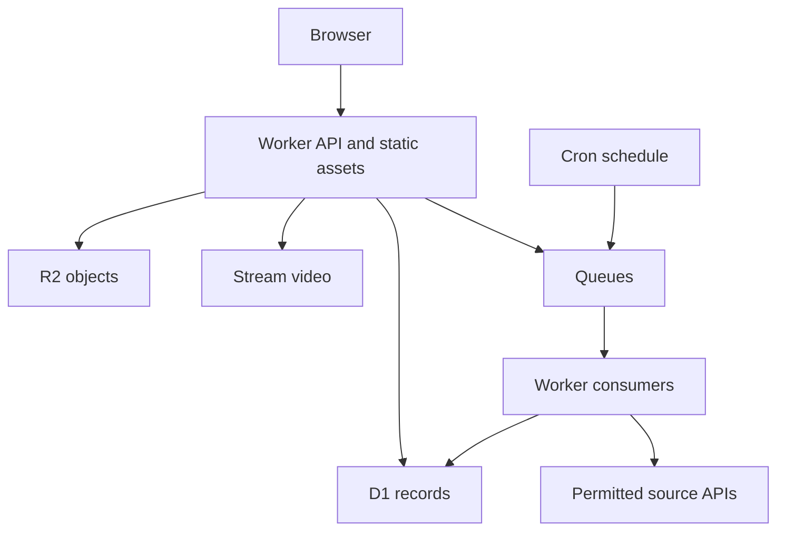

# Cloudflare-Native Architecture
## Chosen stack
TypeScript throughout; React with Vite for the frontend; a small Workers-compatible HTTP router such as Hono for API routes; D1 for relational records; R2 for images and private CV objects; Cloudflare Stream for video encoding and playback; Queues for asynchronous work; Cron Triggers for due work; optional Durable Objects only for demonstrated coordination needs. Serve frontend assets with Workers Static Assets and Cloudflare delivery.

Do not generate Phoenix/LiveView or an external application server. All first-party application compute runs on Cloudflare. Source APIs and optional outbound delivery providers remain external integrations, not application hosting.

## Request and work paths

## Boundaries
Identity, profiles, organizations, jobs, feed, applications, media, sources, notifications and moderation are separate modules with shared authorization utilities. Start as a modular monolith with separate queue handlers; avoid unnecessary microservices.

Use D1 as the authoritative source for membership, sessions and application state. KV, if added, holds only cacheable non-authoritative data. Do not depend on an eventually consistent cache to revoke access.

## Regional behavior
The CDN delivers cacheable public assets globally. Country selection filters application data; it does not imply every database is replicated in every country. IP-derived country is a suggestion, not eligibility evidence or proof of residency. Do not promise regulatory residency from CDN geography. Review service-specific location controls before making residency commitments.

## Consistency and async delivery
Use conditional writes and transactions/batches supported by the selected D1 client, verifying rollback semantics. Application mutations plus audit/outbox events must commit atomically. An outbox dispatcher publishes pending work to Queues. Consumers are idempotent using unique event keys. Treat delivery as potentially repeated; record attempts, backoff, dead-letter state and manual replay.

## Search and scaling
Start with indexed SQL filters, normalized skill joins and bounded keyword search. Validate any full-text option against current D1 support before adopting it. Cursor-paginate feeds and lists, cap page sizes and avoid unbounded scans. Measure query plans, read/write volume and per-database capacity before introducing partitioning. Global CDN does not eliminate database bottlenecks.

## Media
Authorize short-lived upload intents. Validate type, size, ownership and quotas server-side. Images/CVs enter private quarantine in R2 until validated. Video uses one-time direct uploads to Stream; verify processing callbacks and reconcile missed events. Keep credentials server-side. Stream is a separate cost-bearing capability, not an assumed free R2 transcoder.

## Dependency and cost rules
Pin tested package versions and a Workers compatibility date during implementation. Maintain a cost worksheet for requests/CPU, D1 reads/writes/storage, R2 operations/storage, video minutes, Queues and optional services. No numeric free-tier promises are part of this specification. Check current official limits before deployment.
